<div align="center">


# Fail2ban

**飞牛 fnOS 原生 Fail2ban 管理面板** · 概览 / Jail / 封禁 / 过滤器 / 联动 / 日志 / 通知

纯 Python 3 标准库后端 · 原生 JS 前端 · 零第三方依赖 · 桌面端与手机端自适应

[功能](#功能一览) · [截图](#界面预览) · [安装](#安装) · [使用手册](#使用手册) · [常见问题](#常见问题) · [更新日志](CHANGELOG.md) · [English](README_EN.md)

</div>

---

## 这是什么

Fail2ban 把宿主机上已在运行的 fail2ban 做成一个可以在飞牛 fnOS 桌面直接点开的原生应用（`.fpk`）。
它不是一个「换个皮的网页壳」：

- **面板自带一个本地服务**，浏览器只跟它通信，所有请求由面板代为执行；
- **所有写入集中在一个文件** `jail.d/50-fn-fail2ban.local`，系统自带的 `jail.conf` 与 `jail.local` 一律不动；
- **不用额外装 Python 包、Node、数据库**：后端只用 Python 3 标准库，前端是原生 JS 与 CSS，离线可用；
- **一个包通吃 x86 与 ARM** 飞牛设备（应用本身不含任何架构相关二进制）。

它适合这样的场景：想确认 SSH 防护还在生效、昨晚封了哪些 IP、某个 IP 是不是封错了要解开、
封禁时长太短想调长、家里换了网段要把白名单补上、被封的时候希望手机能收到一条推送 ——
这些事本来都要 ssh 进去敲 `fail2ban-client`，现在扫一眼就能做完。

> 面板是 **管理界面**，不是 fail2ban 本身。防火墙规则的执行仍由 fail2ban 负责，
> 面板只负责读写它的配置、读它的日志、给它发指令。

---

## 功能一览

| 模块 | 能力 |
|---|---|
| **概览** | 四张数字卡：运行中的 Jail、当前封禁 IP、累计封禁次数、失败尝试；服务状态（systemd / 开机自启 / 版本 / 控制套接字 / 客户端）与系统环境（面板版本 / 系统 / 内核 / 架构 / 主机名 / 运行时长 / Python）；启动、停止、重启、重载配置四个按钮；下方是「防护中的 Jail」表 |
| **Jail 管理** | 列出系统里全部 Jail：接管状态、启用状态、运行状态、maxretry / findtime / bantime、当前封禁 / 累计封禁 / 失败次数；按「已启用 / 运行中 / 已接管 / 全部」筛选、按名称或过滤器搜索、按任意字段排序；每个 Jail 可打开配置抽屉逐项修改，也可直接看它 logpath 指向的日志尾部 |
| **封禁管理** | 同一 IP 命中多个 Jail 只显示一行并标注命中项；带封禁时间、到期时间与剩余时长（永久封禁只显示封禁时间）；按 IP 搜索、排序、一键复制；手动封禁单个 IP，单个解封与勾选批量解封、「全部解封」 |
| **过滤器** | 系统与自定义 filter 一览，标出哪些正被启用的 Jail 引用；按「已启用 / 未启用 / 全部」分类；新建、编辑、删除自定义过滤器（只写本地文件，不碰系统自带版本）；内置常用模板，填端口与日志路径即可生成 |
| **fn-knock 联动** | 与「敲门」的通用黑名单双向打通：fail2ban 封禁的 IP 同步进敲门黑名单，敲门也会把封禁动作交给自己的执行器；自动装好对应的 action 文件与过滤器。按「封禁方式 / 同步 / 连接 / 运行状态 / 黑名单 / 联动日志」分块，一次只看一块 |
| **日志** | 解析 `fail2ban.log`，最新的行在最上面；按「全部 / 封禁 / 解封 / 失败 / 警告 / 错误」筛选；关键字过滤、行数选择（100 ～ 2000）、导出、刷新、自动刷新（5 秒一次，保持滚动位置不跳）；超长记录折叠成一行摘要，展开可看全文 |
| **设置 · 面板** | 界面语言、侧栏布局、表格密度、日志行数上限等偏好，保存在设备本地 |
| **设置 · 外观** | 浅色 / 深色 / 跟随系统三态主题；中英双语切换即时生效 |
| **设置 · 防护策略** | 全局 maxretry / findtime / bantime / 白名单；白名单是一行一个地址的列表，可逐行编辑、删除，重复项会被拒绝 |
| **设置 · 通知** | 十一种推送渠道；四类事件逐条开关；每次推送留一条投递记录（成功失败都记，失败带原因），可筛选、清空 |
| **设置 · 维护** | 把托管的配置、自定义过滤器与面板设置打包导出（下载到本地或写入设备备份目录）；自动备份（间隔 + 保留份数）；备份列表里可以恢复或删除某一份 |
| **设置 · 存储** | 数据目录与各子目录各占多少空间；清理日志、清理旧备份、全部清理；日志在服务运行期间就地截断，不会漏掉正在写入的内容 |
| **设置 · 更新** | 读取 GitHub 最新发布版本并与当前版本对比；**一键更新**（先校验安装包，装不上自动回滚） |
| **设置 · 说明** | 面板写入的每一个位置集中列在一页：面板的界面 / 数据 / 配置 / 备份 / 日志目录、fail2ban 的系统配置文件与读取顺序、敲门联动写入的动作与过滤器。每条路径都能一键复制 |
| **设置 · 关于** | 版本、fail2ban 引擎版本、监听端口、项目地址、原版作者、许可协议 |
| **移动端** | 抽屉式侧栏、卡片堆叠布局、表格横向滑动、无横向溢出 —— 在飞牛手机 App 内嵌浏览器里同样顺手 |

### 支持的通知渠道

钉钉机器人（含加签） · 企业微信群机器人 · 企业微信应用消息 · 飞书自定义机器人 ·
Bark（iOS） · Slack · Server 酱 · PushPlus · WxPusher · Telegram · 自定义 Webhook。

订阅事件四类：**新封禁 IP** · **解封 IP** · **服务异常** · **服务恢复**。

推送消息是中英双语同条（标题 `中文 / English`，正文中文段 + 空行 + 英文段）——
收件人的手机语言往往与面板界面语言无关，两种都写才都读得懂。

---

## 界面预览

桌面端（1440px）：

| 概览 · 浅色 | 概览 · 深色 |
|---|---|
| 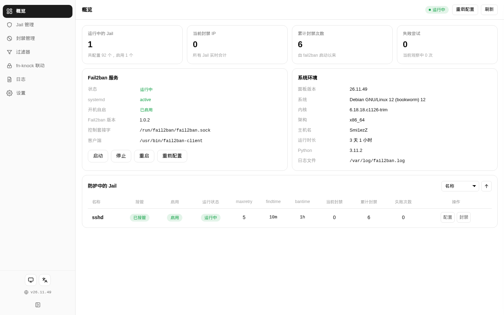 | 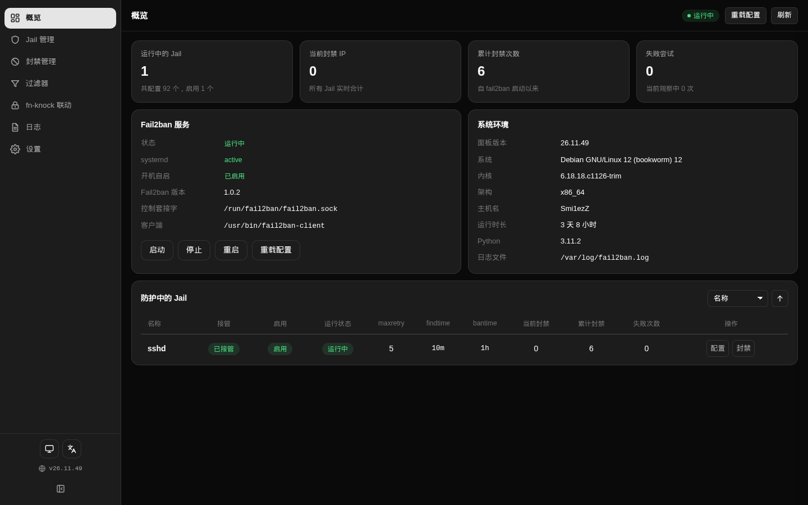 |

| Jail 管理 | 封禁管理 |
|---|---|
| 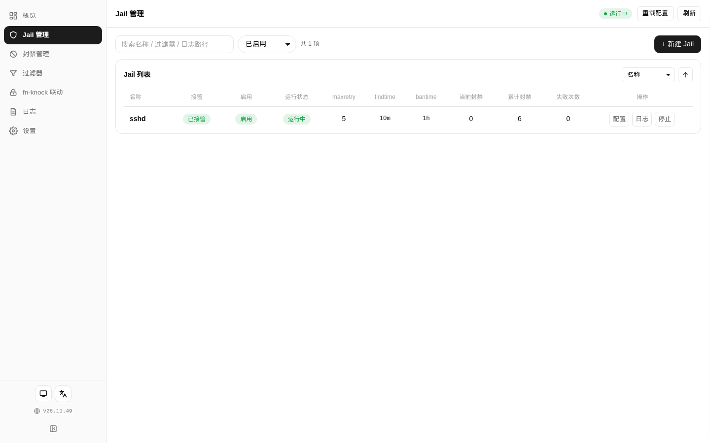 | 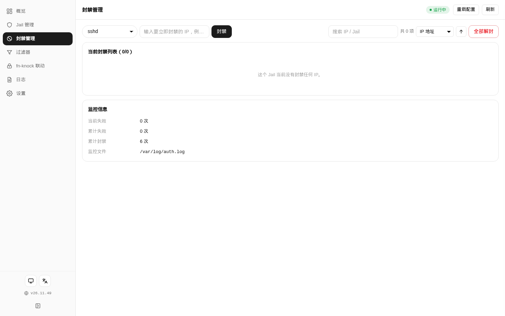 |

| 过滤器 | fn-knock 联动 |
|---|---|
| 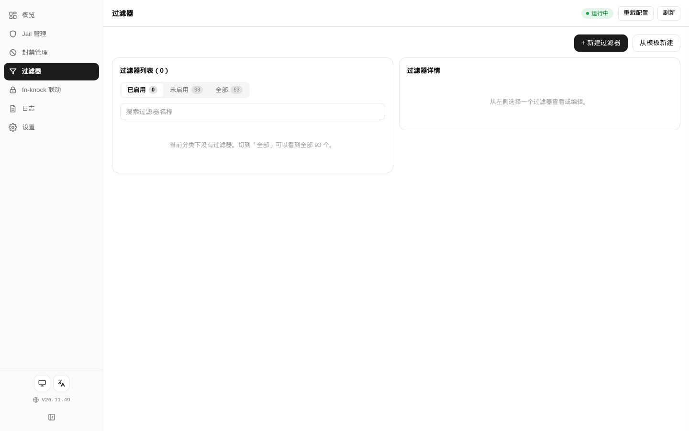 | 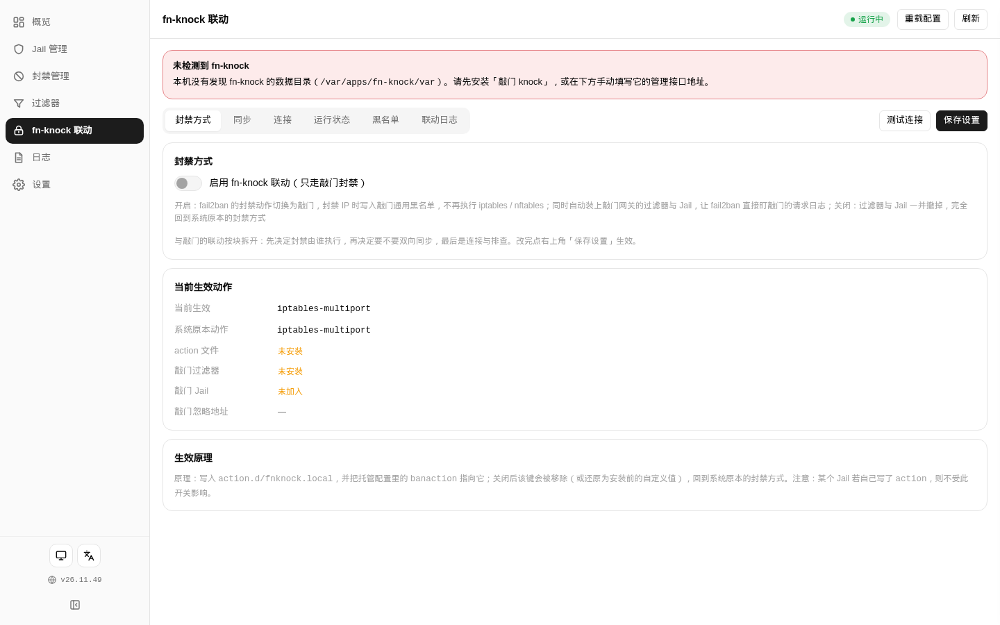 |

| 日志 | 通知 |
|---|---|
| 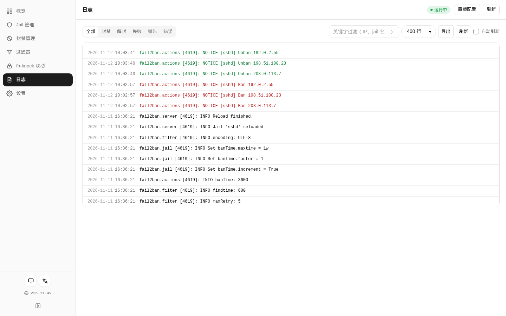 | 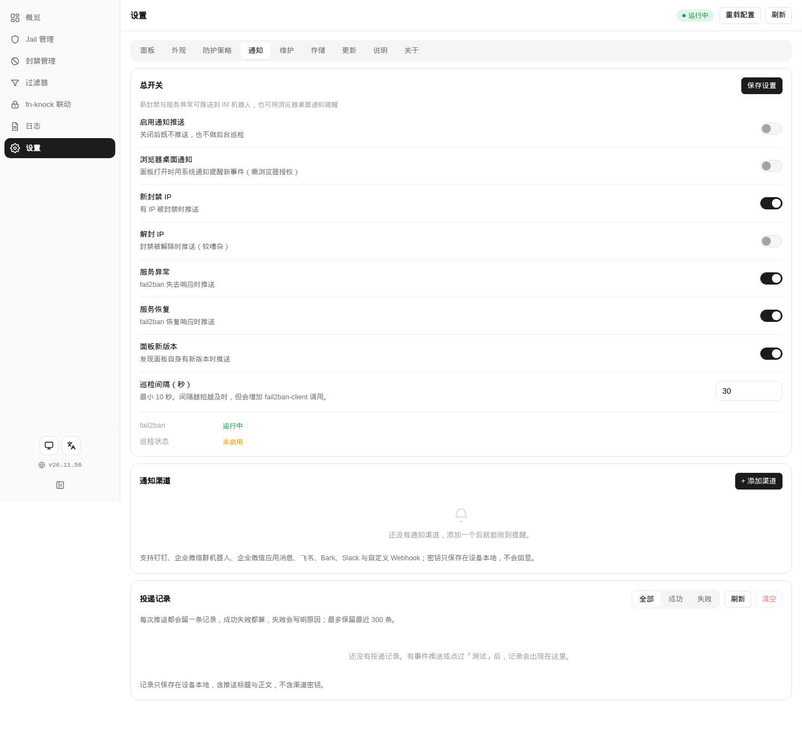 |

| 存储 | 更新 |
|---|---|
| 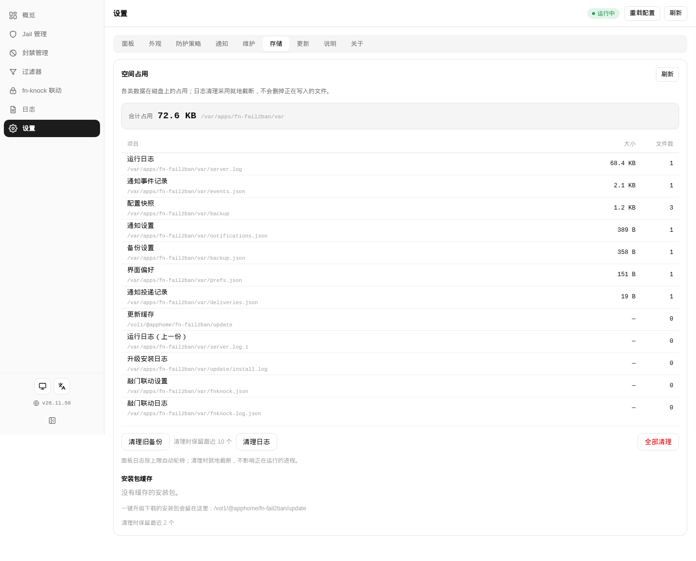 | 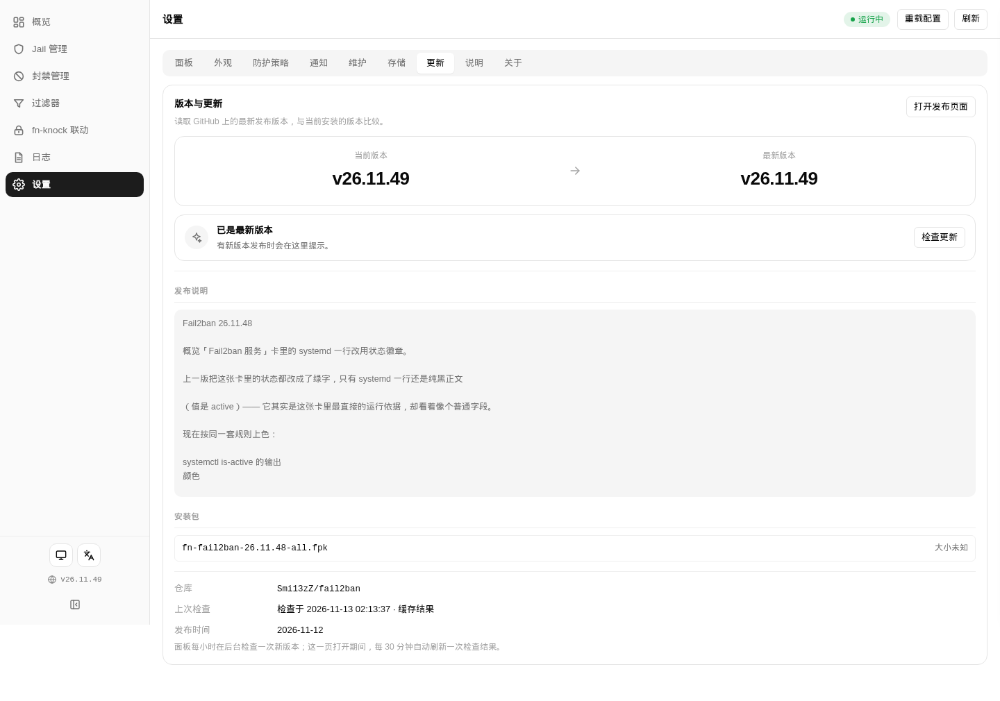 |

| 防护策略 | 说明 |
|---|---|
| 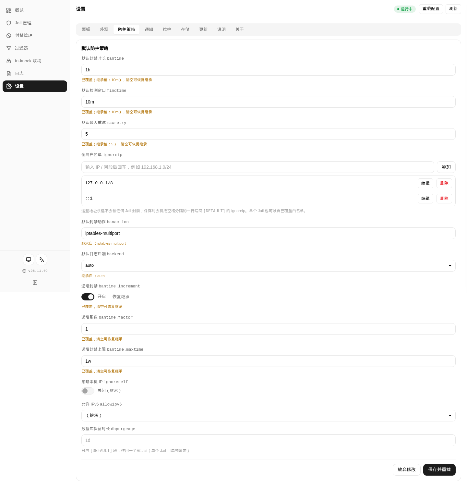 | 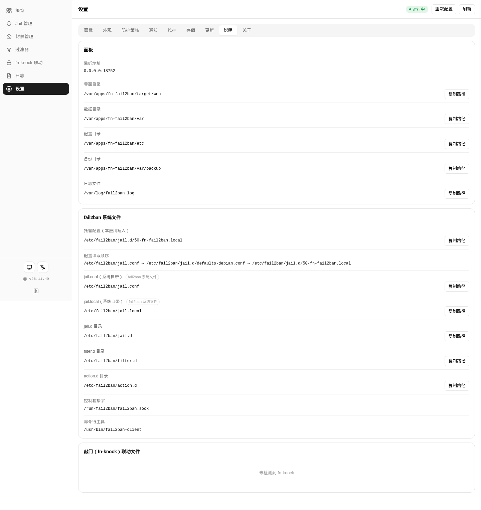 |

手机端（390px）：

| 概览 | Jail 管理 | 通知 |
|---|---|---|
| 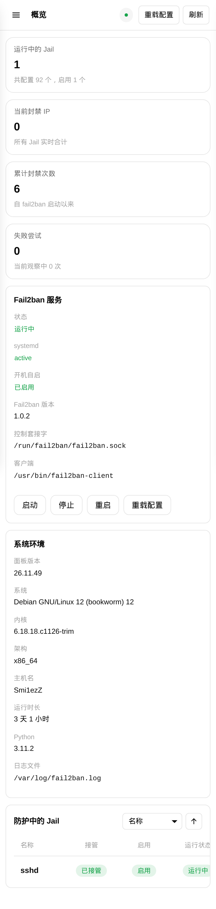 | 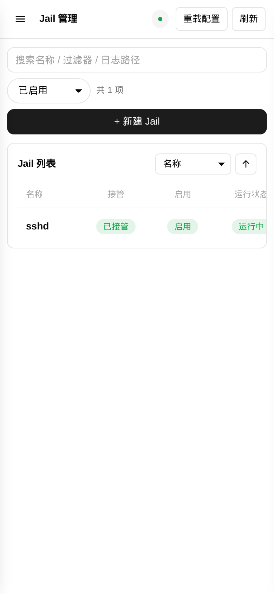 | 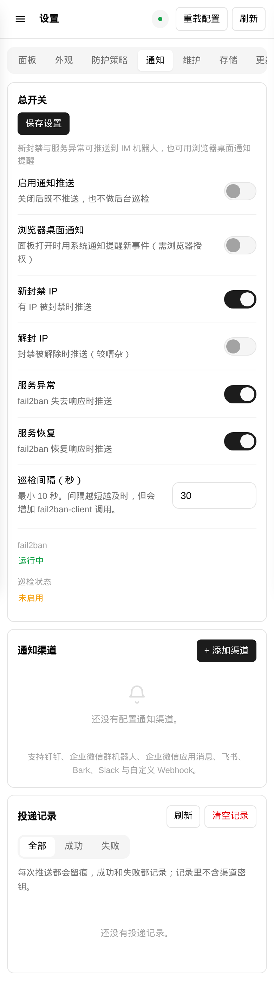 |

---

## 安装

### 前置条件

- 一台飞牛 fnOS 设备（x86 或 ARM 均可），系统已内置 Python 3；
- 宿主机上要有 fail2ban。安装向导里可以勾选「自动安装 Fail2ban」，安装过程会用
  `apt` 拉起（需要联网与 root 权限）；已经装过的不会被动。

### 方式一：应用中心手动安装（推荐）

1. 到本仓库的 [Releases](https://github.com/Smi13zZ/fail2ban/releases/latest) 页面下载最新的 `fn-fail2ban-<版本>-all.fpk`；
2. 打开飞牛 fnOS → **应用中心** → **手动安装**，选择刚下载的 fpk；
3. 按向导确认初始策略（见下）；
4. 装好后飞牛桌面会出现 **Fail2ban** 图标，点开即用，**不需要登录**。

向导会问五件事：

| 步骤 | 字段 | 默认 |
|---|---|---|
| 运行环境 | 自动安装 Fail2ban（系统没有时用 apt 拉起） | 开启 |
| 初始防护策略 | 启用 SSH 防护（sshd） | 开启 |
| 初始防护策略 | 默认封禁时长 | 1 小时 |
| 初始防护策略 | 默认最大重试次数 | 5 次 |
| 初始防护策略 | 全局白名单 | 内网网段 |

### 方式二：命令行安装

```bash
appcenter-cli install-fpk /path/to/fn-fail2ban-26.11.55-all.fpk
```

> `appcenter-cli` **不会覆盖已安装的同名应用**（只回一句 `is installed`），
> 且第三方应用的 `uninstall` 会被拒绝。真正的升级路径只有应用中心 Web UI。

### 安装位置

| 内容 | 路径 |
|---|---|
| 程序 | `/vol1/@appcenter/fn-fail2ban`（内层 `app.tgz`） |
| 生命周期脚本与 manifest | `/var/apps/fn-fail2ban` |
| 配置、偏好、备份、更新日志 | `/var/apps/fn-fail2ban/var` |
| 托管的 Jail 配置 | `/etc/fail2ban/jail.d/50-fn-fail2ban.local` |

---

## 使用手册

### 1. 第一次打开

没有登录页，打开就是管理界面。访问控制按网段白名单（`F2B_ALLOW_CIDRS`），
默认放行回环与内网网段（`127.0.0.0/8 ::1 192.168.0.0/16 10.0.0.0/8 172.16.0.0/12`）。

### 2. 概览页

上面四张数字卡各自独立，一个数字异常不会被另一个盖住。中间两张卡分别是 fail2ban 服务的
运行依据（systemd unit、开机自启、版本、套接字、客户端）和面板所在机器的系统环境。

**状态文字的颜色是有约定的**：正常态（运行中 / 已启用 / 已安装 / 可读）绿字，
未就绪态（未检测到 / 未找到 / 未安装 / 未加入 / 无响应 / 已停止 / 未启用）橙字，
无从判断（`—`）灰字。`systemd` 那一行故意不翻译，保持 `systemctl is-active` 的原样输出 ——
排查故障时要拿界面上的字去和命令行对账。

页面每 30 秒自动刷新一次，切回窗口时若已过期会补刷一次。

### 3. Jail 管理

表格一行一个 Jail，三列状态并排：**接管**（本应用是否写入它的配置）、**启用**（fail2ban 是否启用了它）、
**运行状态**（引擎此刻是否在跑它）。三者是不同的事 —— 停掉一个已启用的 Jail 之后它仍然启用，只是没在运行。

每行右侧：**配置**（打开抽屉逐项改）、**日志**（直接看它的 logpath 末尾）、**启动 / 停止**。
表格较宽时可以横向滑动查看全部列。

### 4. 封禁管理

同一 IP 命中多个 Jail 只会出现一行，标注命中了哪些。每行可以复制 IP、解封。
顶部可以手动封禁一个 IP（立即生效），也可以勾选多个批量解封，或者点「全部解封」。

封禁时间与到期时间来自解析 fail2ban 日志，日志被清空或服务从未启动过时显示 `—`。

### 5. 过滤器

系统自带的 filter 与自定义 filter 混排，每行标出被哪些已启用的 Jail 使用。
自定义过滤器只写 `filter.d` 下的本地文件，不动系统自带版本。
内置模板覆盖常见服务（nginx / apache / sshd / 各类带 JSON 日志的自建服务等），
填端口与日志路径就能生成一条能用的规则。

### 6. 通知

「设置 → 通知」里添加渠道，四类事件可以逐条开关。每个渠道都能单独「测试」。

密钥字段存进设备后，接口只会回传 `__SET__` 掩码；编辑时输入框留空表示保留原值 ——
**不要**把掩码填回输入框，那会被当成新密钥存下来。

投递记录会连失败一起记：只记成功的记录等于没有记录。

### 7. 备份与更新

**维护**：托管的配置、自定义过滤器与面板设置可以整体打包，下载到本地或直接写入设备的备份目录；
也可以开启自动备份（间隔 + 保留份数），保留期只清理自动备份，不动手动导出的。
备份列表里每一份都能恢复——恢复是覆盖性操作，会先确认。

**更新**：后台每小时自查一次（与浏览器开没开无关）。发现新版本可以一键更新 ——
面板下载安装包、校验通过后才动手，装不上会自动回滚。升级过程中页面会自动等待新版本上线。

### 8. 手机端与深链

在飞牛 App 里打开会自动切换移动布局；浏览器直接访问时宽度小于 720px 也进入同一套布局。

页面切换用的是 hash，可以直接打开某个页面或某个设置分区：

| 地址 | 打开 |
|---|---|
| `#dashboard` | 概览 |
| `#jails` | Jail 管理 |
| `#bans` | 封禁管理 |
| `#filters` | 过滤器 |
| `#fnknock` | fn-knock 联动 |
| `#logs` | 日志 |
| `#settings` | 设置（默认「面板」分区） |
| `#settings/notify` | 设置 → 通知 |
| `#settings/storage` | 设置 → 存储 |

设置分区一共九个：`panel` / `appearance` / `policy` / `notify` / `maint` / `storage` /
`update` / `guide` / `about`。

---

## 常见问题

**面板说「未安装」，但我明明装了 fail2ban**
先看「概览 → Fail2ban 服务 → 状态」。面板按 `fail2ban-client` 的存在与否判断是否安装，
找不到客户端时 `systemd` 那一行会显示 `not-installed`。多数情况是 fnOS 的 PATH 与面板不同，
或者装在了非标准位置。

**封禁列表是空的，但日志里明明有 Ban**
封禁信息来自 `fail2ban-client status <jail>` 与日志解析，两者都要能读到。
先确认该 Jail 当前是运行状态 —— 未运行的 Jail 后端不给 status，面板会整列显示 `—` 而不是假 0。

**解封后 IP 又立刻被封**
解封只是清掉当前的封禁条目，没有改过滤规则。同一个 IP 继续触发失败次数就会再次被封，
要根治得看「Jail 管理 → 配置」里的 maxretry / findtime，或者把它加进白名单。

**改了配置为什么系统没生效**
面板写的是 `jail.d/50-fn-fail2ban.local`，fail2ban 需要重载才会读。
保存后点顶栏「重载配置」，或者到概览页点「重启」。

**推送测试成功，实际封禁却没收到**
先看「设置 → 通知 → 投递记录」有没有对应条目：有记录且失败说明对端拒绝了，
记录里写着原因（HTTP 状态码或平台返回的错误码）；完全没记录说明事件开关没开。

**白名单里的地址被拒绝添加**
同一个地址重复添加会被拒绝；一次只能填一个地址或网段。

**数据存在哪？**
配置、偏好、备份与更新日志都在 `/var/apps/fn-fail2ban/var`。
「设置 → 存储」里能看到每一项各占多少空间，也能一键清理。

---

## 安全说明

- **没有登录页**：打开即进管理界面。访问控制靠网段白名单，默认只放行回环与内网。
  如果这台机器的面板端口暴露到了公网，任何能访问该端口的人都能看到并发起封禁操作，
  请自行在前面加一层认证，或收紧 `F2B_ALLOW_CIDRS`；
- **通知渠道的密钥只存设备本地**：接口回传的是 `__SET__` 掩码，编辑时留空即保留原值；
- **导出到本地的备份里含通知渠道密钥**（文件会离开设备），导出后请妥善保管；
- 面板以 root 运行（要读写 `/etc/fail2ban` 并调用 `fail2ban-client`），这是功能前提。

---

## 已知限制

- **重启服务只能用应用中心或面板按钮**：`systemctl restart fn-fail2ban` 不存在这个 unit；
- **封禁时间来自日志解析**：日志被清空、轮转、或服务从未启动过时，那几列显示 `—`；
- **手机端表格是横向滑动**，没有改成卡片式：Jail 表有 11 列，改成卡片会牺牲可扫读性；
- **不做自动修改系统防火墙策略** —— 那是 fail2ban 自身的职责；
- **面板本身不自愈**：开机自启是有的，但进程被 `kill -9` 后没有东西会把它拉回来，
  到应用中心点一下启动即可。

---

## 从源码构建

源码结构：

```
src/pkg/fn-fail2ban/
├── manifest                 # 应用元信息：包名、版本、端口、平台
├── ICON.PNG / ICON_256.PNG  # 应用图标（64 / 256），文件名必须大写
├── config/                  # 运行身份（root）与应用文件夹声明
├── wizard/                  # 安装向导与卸载向导的字段定义
├── cmd/                     # 生命周期脚本：install / config / upgrade / uninstall / main
└── app/
    ├── bin/                 # 后端（纯 Python 标准库）
    │                        # server.py（HTTP 服务与路由）、f2b.py（fail2ban 客户端封装）、
    │                        # jailconf.py（Jail 配置读写）、banlog.py（日志解析）、
    │                        # notify.py（十一种通道）、delivery.py（投递记录）、
    │                        # backup.py / storage.py / update.py / installer.py
    ├── ui/                  # 桌面入口与九档图标 images/icon_{16..512}.png
    └── web/                 # index.html + style.css + app.js + i18n.js（零构建）
```

仓库自带 `.github/workflows/build-fpk.yml`：推 `v*` 标签会自动构建、校验并发布 Release。
本地打包**只能在 Linux 上做**（Windows 会丢可执行位，安装报 10111），
`tools/build_fpk.py` 通过 SSH 在飞牛设备上用官方 `fnpack` 完成。

完整的开发说明（环境、闸门、真机验证、踩过的坑）见 [docs/DEVELOPMENT.md](docs/DEVELOPMENT.md)。

```bash
python tools/preflight.py                              # 跑齐 CI 的全部闸门
python tools/build_fpk.py --host <设备别名>             # 结构检查 → 打包
python tools/inspect_fpk.py --strict output/xxx.fpk    # 解包核验：执行位 / 九档图标 / 版本号
python tools/shots.py --out image/shots-xxxxxx         # 真机逐页截图（桌面 + 手机）
```

### 端口

面板默认监听 **18752**，绑定 `0.0.0.0`（可由 `F2B_BIND` / `F2B_PORT` 覆盖）。

端口来自 manifest 的 `service_port`，由 fnOS 通过 `TRIM_SERVICE_PORT` 注入。

| 想做什么 | 怎么做 |
|---|---|
| 用默认端口 | 安装时什么都不用改 |
| 换成别的端口 | 改 `src/pkg/fn-fail2ban/manifest` 的 `service_port` 后重新打包安装 |
| 只监听回环 | 环境变量 `F2B_BIND=127.0.0.1`（此时只能靠反向代理访问） |
| 收紧访问网段 | 环境变量 `F2B_ALLOW_CIDRS`，空格或逗号分隔 |

---

## 许可

MIT

本项目与飞牛 fnOS 官方无隶属关系。fnOS 是飞牛（北京）科技有限公司的产品。
