<div align="center">


# Fail2ban

**A native Fail2ban management panel for fnOS** · Overview / Jails / Bans / Filters / Knock sync / Logs / Notifications

Pure Python 3 stdlib backend · vanilla JS front-end · zero third-party dependencies · desktop and mobile friendly

[Features](#features) · [Screenshots](#screenshots) · [Install](#install) · [Usage](#usage) · [FAQ](#faq) · [Changelog](CHANGELOG.md) · [中文说明](README.md)

</div>

---

## What it is

Fail2ban turns the daemon already running on your host into a **native fnOS application** (`.fpk`) that opens
straight from the fnOS desktop. It is not a "wrapped webpage":

- **The panel ships its own local service**; the browser only talks to it, and every request is executed on your behalf.
- **All writes go to one file** — `jail.d/50-fn-fail2ban.local`. The system's own `jail.conf` and `jail.local` are never touched.
- **Zero dependencies.** The backend uses only the Python 3 standard library; the front-end is plain JS and CSS, so everything works offline.
- **One package for both x86 and ARM** fnOS boxes (nothing in the app is architecture-specific).

It is for the questions you end up asking: is SSH protection still on, which IPs got banned last night,
did I ban someone by mistake, is the ban time too short, does the new subnet need to go on the allow list,
and can I get a push notification on my phone when it happens? All of that used to mean SSH plus
`fail2ban-client`; now it is one glance.

> This is a **management UI**, not fail2ban itself. Firewall rules remain fail2ban's job — the panel only reads
> and writes its configuration, parses its logs, and sends it commands.

---

## Features

| Area | What you get |
|---|---|
| **Overview** | Four stat cards: active jails, currently banned IPs, total bans, failed attempts; service state (systemd / start on boot / version / control socket / client) and host environment (panel version / OS / kernel / arch / hostname / uptime / Python); start, stop, restart and reload buttons; a "jails under protection" table below |
| **Jails** | Every jail with its managed state, enabled state, run state, maxretry / findtime / bantime and ban counters; filter by enabled / running / managed / all, search by name or filter, sort by any column; a per-jail config drawer for editing each field, plus a shortcut to that jail's own log tail |
| **Bans** | One row per IP even when it hits several jails (with the list of jails shown); ban time, expiry and remaining time (permanent bans show only the ban time); search, sort, copy; manual ban of a single IP, single unban, multi-select batch unban and "unban all" |
| **Filters** | System and custom filters side by side, each marked with the enabled jails that reference it; grouped by enabled / disabled / all; create, edit and delete custom filters (local files only — system copies are never modified); built-in templates that need nothing but a port and a log path |
| **fn-knock sync** | Two-way link with the "knock" gateway's generic blacklist: IPs banned by fail2ban are mirrored into knock, and knock can route ban actions to its own executor; the matching action file and filter are installed automatically. Split into mode / sync / connection / status / blacklist / sync log, one block at a time |
| **Logs** | Parses `fail2ban.log` with the newest line first; filter by all / ban / unban / failed / warning / error; keyword search, line count (100–2000), export, refresh, auto-refresh every 5 s that keeps your scroll position; very long records collapse to a one-line summary with the full text one click away |
| **Settings · Panel** | UI language, sidebar layout, table density and log line cap, stored on the device |
| **Settings · Appearance** | Light / dark / follow-system themes; instant Chinese–English switch |
| **Settings · Policy** | Global maxretry / findtime / bantime and the allow list; the allow list is one address per row with inline editing and deletion, and duplicates are rejected |
| **Settings · Notifications** | Eleven push channels; four event types with individual toggles; every push leaves a delivery record (successes and failures alike, failures with a reason), filterable and clearable |
| **Settings · Maintenance** | Package the managed config, custom filters and panel settings and export them (download, or write straight to the device backup folder); automatic backups (interval + how many to keep); restore or delete any entry from the backup list |
| **Settings · Storage** | How much the data directory and each of its children take; clean logs, clean old backups, clean everything; logs are truncated in place while the service runs, so nothing still being written is lost |
| **Settings · Update** | Reads the latest GitHub release and compares it with the running version; **one-click update** (package verified first, automatic rollback if the install fails) |
| **Settings · Guide** | Every location the panel writes to, on one page: the panel's own UI / data / config / backup / log directories, fail2ban's system config files and their read order, and the action and filter installed for knock sync. Every path is one click to copy |
| **Settings · About** | Version, fail2ban engine version, listening port, project URL, original author, licence |
| **Mobile** | Drawer sidebar, stacked cards, horizontally scrolling tables, no horizontal overflow — just as usable inside the fnOS phone app's embedded browser |

### Supported notification channels

DingTalk bot (with signing) · WeCom group bot · WeCom app message · Feishu custom bot ·
Bark (iOS) · Slack · ServerChan · PushPlus · WxPusher · Telegram · Custom webhook.

Four event types: **IP banned** · **IP unbanned** · **service down** · **service recovered**.

Every message is bilingual in a single push (title `中文 / English`, then the Chinese paragraph,
a blank line, then the English one). The recipient's phone language often has nothing to do with
the panel's UI language, so both are always included.

---

## Screenshots

Desktop (1440px):

| Overview · light | Overview · dark |
|---|---|
| 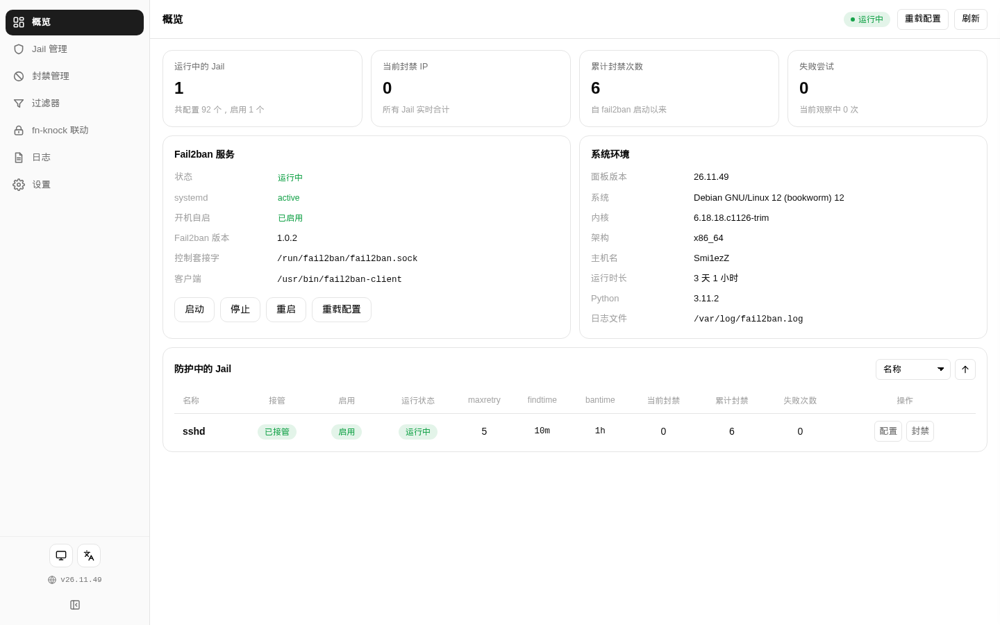 | 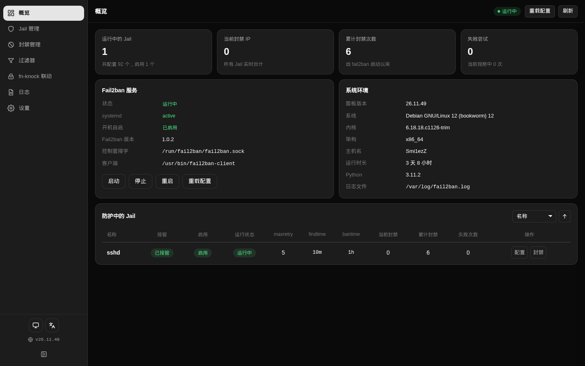 |

| Jails | Bans |
|---|---|
| 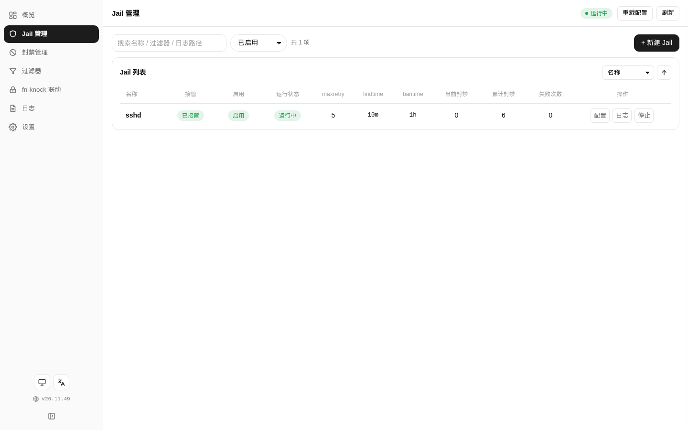 | 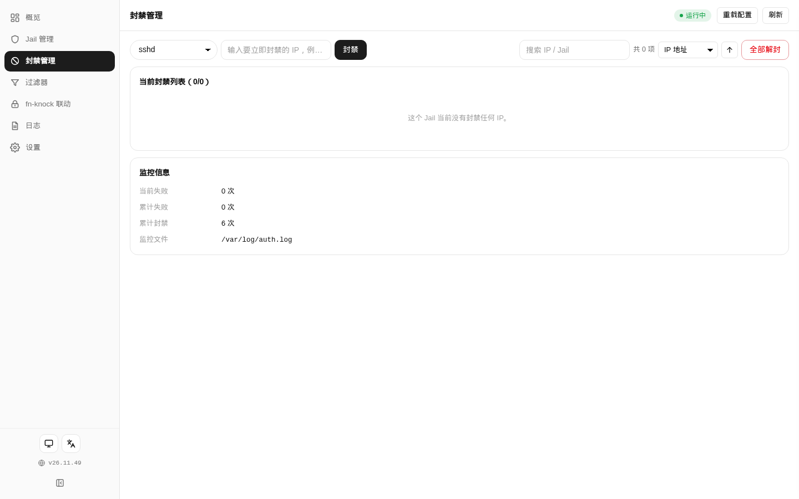 |

| Filters | fn-knock sync |
|---|---|
| 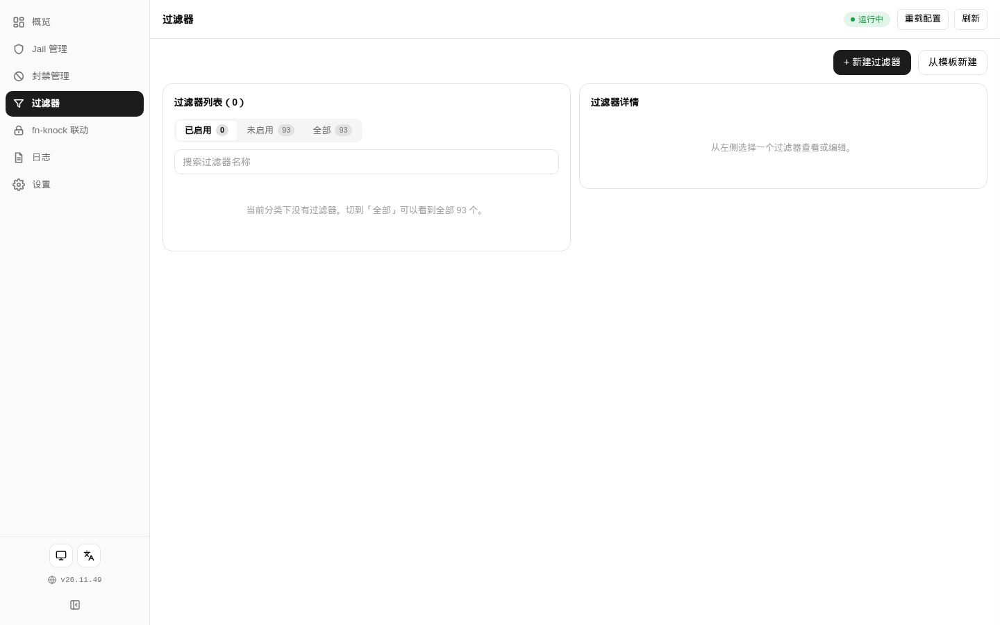 | 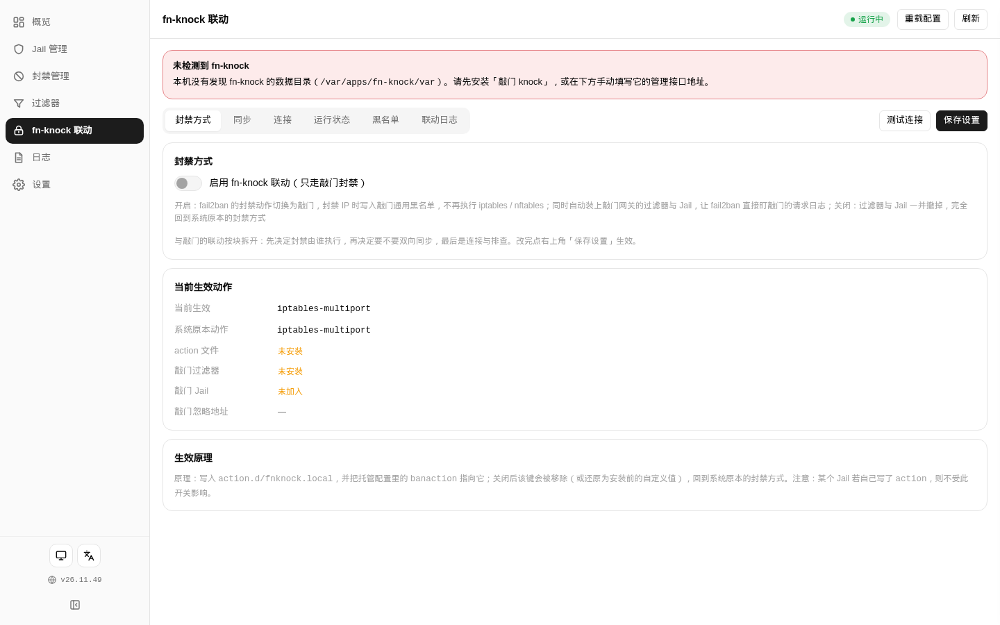 |

| Logs | Notifications |
|---|---|
| 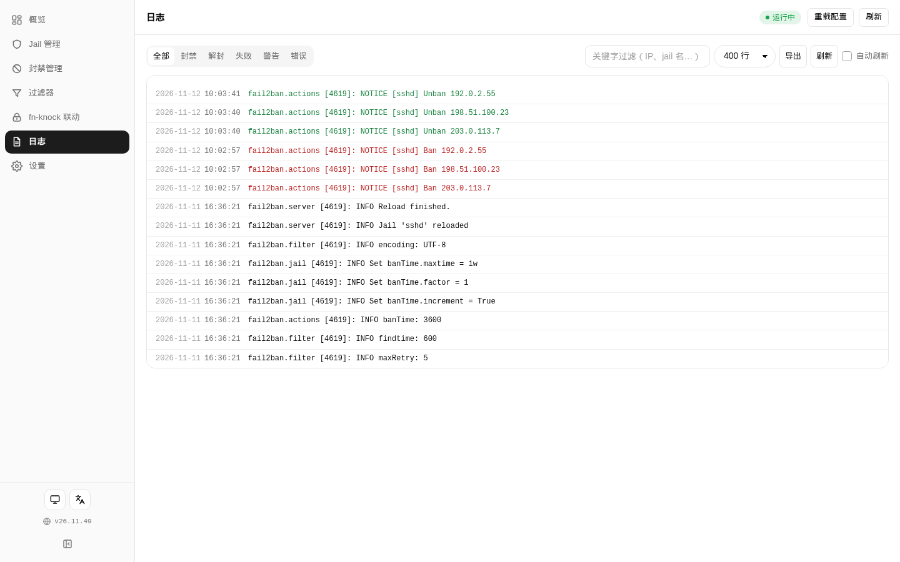 | 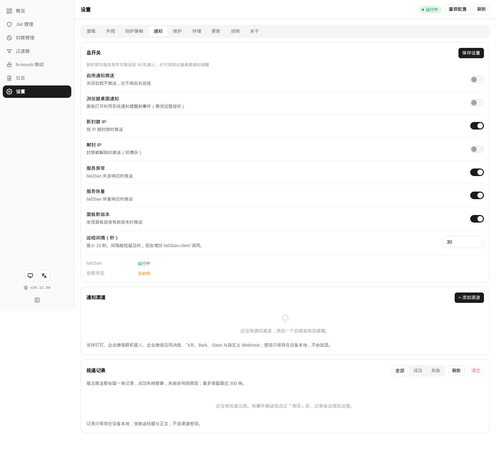 |

| Storage | Update |
|---|---|
| 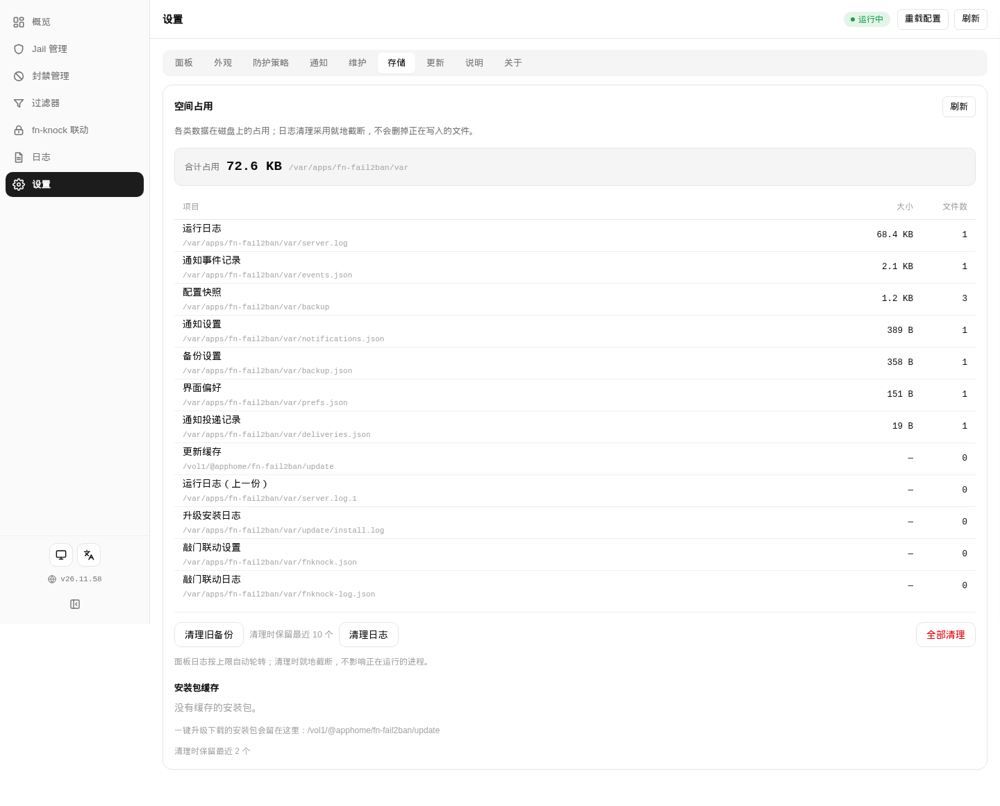 | 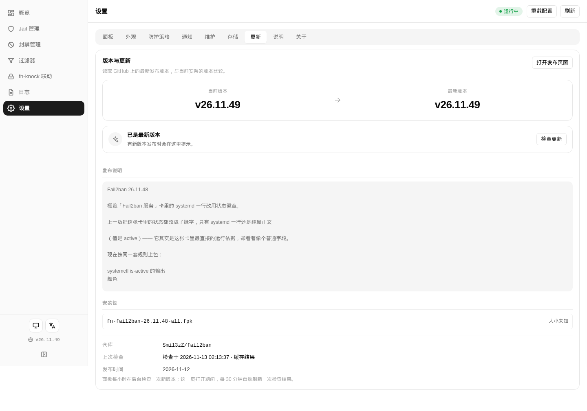 |

| Policy | Guide |
|---|---|
| 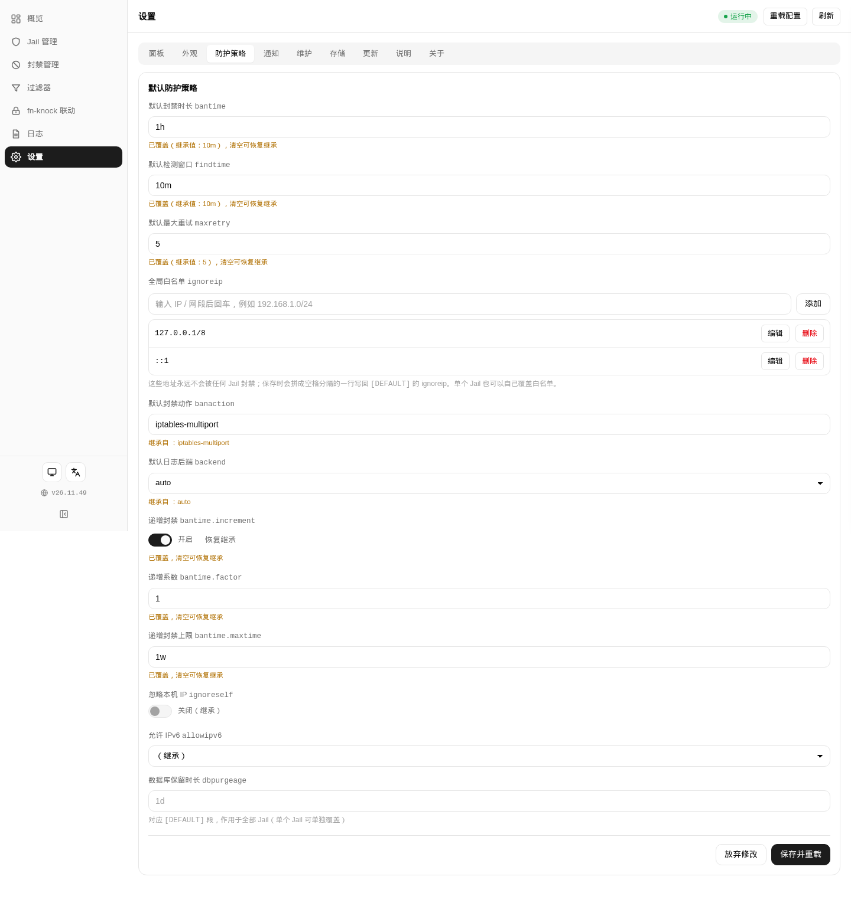 | 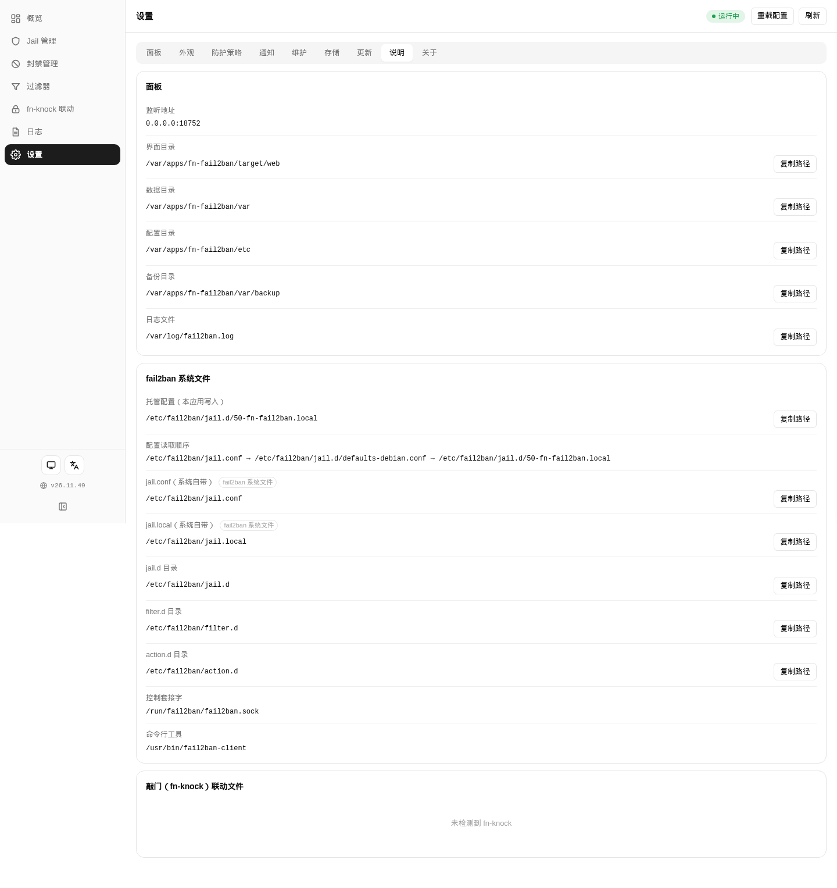 |

Mobile (390px):

| Overview | Jails | Notifications |
|---|---|---|
| 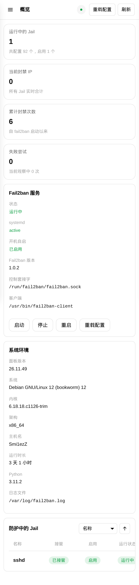 | 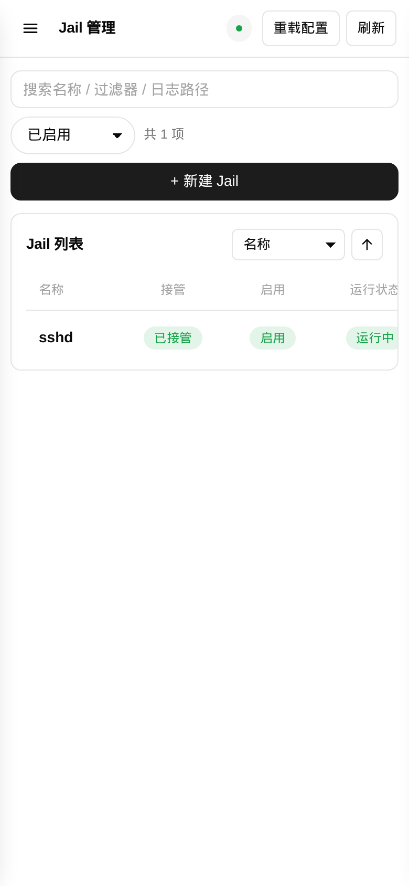 | 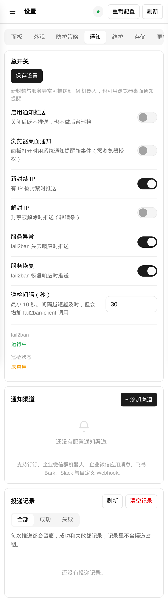 |

---

## Install

### Requirements

- A fnOS device (x86 or ARM), with Python 3 already on the system;
- fail2ban on the host. The wizard offers "install fail2ban automatically", which pulls it in
  with `apt` (needs network and root); an existing installation is left alone.

### Option 1: App Center (recommended)

1. Download the latest `fn-fail2ban-<version>-all.fpk` from [Releases](https://github.com/Smi13zZ/fail2ban/releases/latest);
2. Open fnOS → **App Center** → **Manual install** and pick the file;
3. Confirm the initial policy in the wizard (see below);
4. A **Fail2ban** icon appears on the fnOS desktop — open it and you are in. **There is no login page.**

The wizard asks five things:

| Step | Field | Default |
|---|---|---|
| Environment | Install fail2ban automatically (via apt when missing) | on |
| Initial policy | Enable SSH protection (sshd) | on |
| Initial policy | Default ban time | 1 hour |
| Initial policy | Default max retries | 5 |
| Initial policy | Global allow list | private subnets |

### Option 2: command line

```bash
appcenter-cli install-fpk /path/to/fn-fail2ban-26.11.51-all.fpk
```

> `appcenter-cli` **does not upgrade an installed app** (it just prints `is installed`),
> and `uninstall` is refused for third-party apps. The only upgrade path is the App Center Web UI.

### Where things land

| Content | Path |
|---|---|
| Application | `/vol1/@appcenter/fn-fail2ban` (the inner `app.tgz`) |
| Lifecycle scripts and manifest | `/var/apps/fn-fail2ban` |
| Config, preferences, backups, update logs | `/var/apps/fn-fail2ban/var` |
| Managed jail config | `/etc/fail2ban/jail.d/50-fn-fail2ban.local` |

---

## Usage

### 1. First open

No login page — the panel opens straight into the management UI. Access is restricted by CIDR
(`F2B_ALLOW_CIDRS`), which defaults to loopback and private subnets.

### 2. Overview

The four stat cards are independent, so one bad number cannot hide behind another. The next two
cards hold the evidence behind the fail2ban service (systemd unit, start on boot, version, socket,
client) and the host environment.

**Status colours follow a rule**: healthy states (running / enabled / installed / readable) are green,
not-ready states (not detected / not found / not installed / not added / not responding / stopped / disabled)
are amber, and "cannot tell" (`—`) is grey. The `systemd` row is deliberately **not translated** —
it shows `systemctl is-active` verbatim, because when something breaks you compare that word with the
command line.

The page refreshes itself every 30 s, and catches up when you switch back to the tab.

### 3. Jails

One row per jail, with three status columns side by side: **managed** (does this app write its config),
**enabled** (has fail2ban enabled it) and **run state** (is the engine running it right now).
These are three different things — stopping an enabled jail leaves it enabled, just not running.

On the right of each row: **config** (opens the drawer), **logs** (tails that jail's logpath), and
**start / stop**. Scroll the table sideways on narrow screens to reach every column.

### 4. Bans

One IP appears once even when it hits several jails, with the jails listed. Copy or unban per row.
At the top you can ban an IP immediately, unban a selection, or unban everything.

Ban and expiry times come from parsing the fail2ban log; when the log is empty or the service has
never started, those columns show `—`.

### 5. Filters

System filters and custom ones share one table, each row marked with the enabled jails that use it.
Custom filters are written as local files under `filter.d`; the system copies are never modified.
The built-in templates cover common services (nginx, apache, sshd, and self-hosted services that
log JSON), and need nothing but a port and a log path.

### 6. Notifications

Add channels under **Settings → Notifications**; each of the four event types toggles independently,
and every channel can be tested on its own.

Once a secret is stored, the API only ever returns the `__SET__` mask. Leaving the field empty when
editing means "keep the current value" — **do not** paste the mask back in, it would be stored as the
new secret.

Delivery records include failures: a log of successes only is not a log.

### 7. Backups and updates

**Maintenance**: the managed config, custom filters and panel settings can be packaged as one archive and
either downloaded or written straight into the device backup folder. Automatic backups take an interval and
a keep count; retention only prunes automatic backups, manual exports stay. Any entry in the backup list
can be restored — that overwrites the current configuration, so the panel asks first.

**Update**: the panel checks hourly in the background, whether or not a browser is open. When a new
version appears, one click downloads it, verifies the package, and only then swaps it in — a failed
install rolls back. The page waits for the new version to come up.

### 8. Mobile and deep links

Opening the panel inside the fnOS app switches to the mobile layout; in a plain browser the same
layout kicks in below 720px.

Navigation is hash-based, so any page can be opened directly:

| URL | Opens |
|---|---|
| `#dashboard` | Overview |
| `#jails` | Jails |
| `#bans` | Bans |
| `#filters` | Filters |
| `#fnknock` | fn-knock sync |
| `#logs` | Logs |
| `#settings` | Settings (Panel) |
| `#settings/notify` | Settings → Notifications |
| `#settings/storage` | Settings → Storage |

Settings has nine tabs: `panel` / `appearance` / `policy` / `notify` / `maint` / `storage` /
`update` / `guide` / `about`.

---

## FAQ

**The panel says "not installed" but fail2ban clearly is**
Look at **Overview → Fail2ban service → Status**. The panel decides on the presence of
`fail2ban-client`; when it cannot find it, the `systemd` row reads `not-installed`.
Most of the time the panel's PATH differs from your shell, or fail2ban lives somewhere non-standard.

**The ban list is empty even though the log shows bans**
Ban data comes from both `fail2ban-client status <jail>` and log parsing. First check that the jail
is actually running — a stopped jail has no status, and the panel shows `—` rather than a fake 0.

**An IP gets re-banned right after I unban it**
Unbanning only clears the current entry; it does not change the rule. If the IP keeps failing it will
be banned again. To fix it properly, tune maxretry / findtime in **Jails → config**, or add the
address to the allow list.

**I changed the config but nothing happened**
The panel writes `jail.d/50-fn-fail2ban.local`, and fail2ban has to reload to read it.
Hit **Reload** in the top bar after saving, or **Restart** on the overview page.

**The test push works but real bans never arrive**
Check **Settings → Notifications → delivery records** for the matching entry. An entry with a failure
means the remote side rejected it and the reason (HTTP status or the platform's own error code) is
in the record. No entry at all means the event toggle is off.

**The allow list rejects my address**
Duplicates are rejected, and each submission takes exactly one address or CIDR.

**Where is my data?**
Config, preferences, backups and update logs live in `/var/apps/fn-fail2ban/var`.
**Settings → Storage** shows what each part takes and can clean it up.

---

## Security notes

- **There is no login page.** Access control is the CIDR allow list, which defaults to loopback and
  private subnets. If the panel port is reachable from the internet, anyone who can open it can read
  the state and issue bans — put authentication in front of it, or tighten `F2B_ALLOW_CIDRS`.
- **Channel secrets stay on the device**; the API returns the `__SET__` mask, and leaving the field
  empty on edit keeps the stored value.
- **A configuration exported to your computer contains those secrets** (it leaves the device) —
  store it accordingly.
- The panel runs as root, because it must write `/etc/fail2ban` and call `fail2ban-client`.

---

## Known limits

- **Restart the service from App Center or the panel**: there is no `systemctl` unit named
  `fn-fail2ban`;
- **Ban times come from log parsing**: an emptied or rotated log, or a service that never started,
  leaves those columns at `—`;
- **Tables scroll sideways on phones** instead of turning into cards: the jail table has 11 columns,
  and cards would cost the ability to scan a column;
- **The panel does not touch firewall policy itself** — that is fail2ban's job;
- **The panel does not self-heal**: start on boot is there, but nothing restarts it after a `kill -9`
  — hit start in App Center.

---

## Building from source

Layout:

```
src/pkg/fn-fail2ban/
├── manifest                 # app metadata: package name, version, port, platform
├── ICON.PNG / ICON_256.PNG  # app icons (64 / 256); the case of these names matters
├── config/                  # run identity (root) and folder declarations
├── wizard/                  # install and uninstall wizard field definitions
├── cmd/                     # lifecycle scripts: install / config / upgrade / uninstall / main
└── app/
    ├── bin/                 # backend, pure Python 3 stdlib
    │                        # server.py (HTTP and routing), f2b.py (fail2ban client wrapper),
    │                        # jailconf.py (jail config r/w), banlog.py (log parsing),
    │                        # notify.py (eleven channels), delivery.py (delivery records),
    │                        # backup.py / storage.py / update.py / installer.py
    ├── ui/                  # desktop entry and nine icon sizes images/icon_{16..512}.png
    └── web/                 # index.html + style.css + app.js + i18n.js (no build step)
```

The repo ships `.github/workflows/build-fpk.yml`: pushing a `v*` tag builds, verifies and publishes
a release. Packaging **must happen on Linux** (Windows loses the executable bit and installation
fails with 10111); `tools/build_fpk.py` drives the official `fnpack` on an fnOS device over SSH.

The full development guide (environment, gates, on-device verification, and the traps hit along
the way) is in [docs/DEVELOPMENT.md](docs/DEVELOPMENT.md).

```bash
python tools/preflight.py                              # every CI gate in one command
python tools/build_fpk.py --host <device-alias>        # structure checks, then packaging
python tools/inspect_fpk.py --strict output/xxx.fpk    # unpack and verify bits, icons, version
python tools/shots.py --out image/shots-xxxxxx         # real-device screenshots (desktop + mobile)
```

### Port

The panel listens on **18752**, bound to `0.0.0.0` (override with `F2B_BIND` / `F2B_PORT`).

The port comes from `service_port` in the manifest, injected by fnOS as `TRIM_SERVICE_PORT`.

| Goal | How |
|---|---|
| Use the default port | Nothing to do at install time |
| Pick another port | Change `service_port` in `src/pkg/fn-fail2ban/manifest`, then rebuild and reinstall |
| Loopback only | Set `F2B_BIND=127.0.0.1` (then reach it through a reverse proxy) |
| Restrict source subnets | Set `F2B_ALLOW_CIDRS`, space- or comma-separated |

---

## Licence

MIT

This project is not affiliated with fnOS or its vendor. fnOS is a product of Feiniu (Beijing) Technology Co., Ltd.
